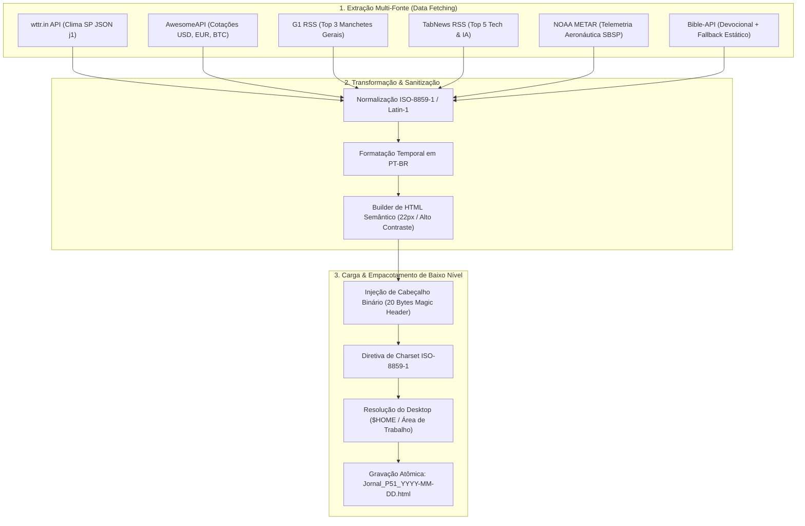

# Jornal P-51

> **Pipeline ETL autônomo e protocolo binário para geração de briefings matinais ultraleves com telemetria meteorológica, financeira e aeronáutica.**

<div align="center">
  <video src="./assets/demo.mp4" width="100%" controls autoplay muted loop></video>
</div>

---

## 📌 Resumo Executivo

No início de cada dia, profissionais técnicos e operadores de sistemas enfrentam o atrito de abrir múltiplas abas pesadas de navegadores para consolidar informações essenciais de rotina: previsão meteorológica, cotações cambiais e criptoativos, manchetes de tecnologia, devocional matinal e boletins meteorológicos aeronáuticos. Essa sobrecarga consome tempo, largura de banda e centenas de megabytes de memória RAM. Além disso, dispositivos embarcados, terminais com recursos restritos e leitores dedicados do ecossistema P-51 são incapazes de processar a complexidade de motores Chromium modernos.

O **Jornal P-51** resolve essa fricção por meio de uma arquitetura determinística de **Extração, Transformação e Carga (ETL)**. O sistema consulta concorrentemente seis fontes de dados em tempo real, efetua a sanitização e normalização de caracteres para a codificação `ISO-8859-1`, constrói um layout HTML semântico com tipografia de alto contraste e injeta um cabeçalho binário proprietário de 20 bytes (*magic bytes*). O artefato final é despachado atomicamente na Área de Trabalho do usuário com nomenclatura temporal, pesando menos de 4 KB — uma redução de mais de 99% em relação a qualquer página web tradicional.

Construído em **Python 3**, o projeto alia baixo consumo computacional, resiliência operacional (com fallbacks estáticos para cenários de queda de rede) e compatibilidade direta com hardware de baixo nível, permitindo tanto o consumo rápido pelo usuário em desktops quanto a sincronização com microcontroladores e visores dedicados.

---

## 🏗️ Arquitetura & Fluxo de Dados (ETL)

O fluxo do sistema é estritamente desacoplado em três etapas sequenciais:



---

## 🚀 Funcionalidades Principais

1. **Extração Concorrente e Resiliente**:
   - Integração com `wttr.in` com extração de temperatura instantânea, sensação térmica, mín/máx e condições em português.
   - Cotações financeiras em tempo real via AwesomeAPI com conversão monetária para o padrão brasileiro (`R$ 0,00`).
   - Leitura e parsing de feeds RSS com `feedparser` para Manchetes do G1 e discussões de ponta do TabNews (Tecnologia & IA).
   - Coleta de boletim meteorológico oficial da aviação civil (**METAR SBSP - Aeroporto de Congonhas / SP**) via NOAA NWS.
   - Provedor devocional bíblico automatizado com catálogo local de contingência (*offline fallback guard*).

2. **Engenharia de Baixo Nível & Compatibilidade P-51**:
   - Injeção direta de assinatura binária de 20 bytes (`\xB3\x00\x00\x00\x01\x00\x00\x00\x15\x00\x00\x00\x5A\x00\x00\x00\x30\x00\x00\x00`) permitindo que dispositivos e displays dedicados identifiquem a estrutura do stream sem interpretador DOM pesado.
   - Conversão de codificação UTF-8 para `ISO-8859-1` (*Latin-1*) com tratamento de caracteres especiais.

3. **Geração Atômica & Despacho Autônomo**:
   - Localização automática da pasta `Desktop` ou `Área de Trabalho` em sistemas operacionais Windows e Linux/macOS.
   - Nomenclatura dinâmica baseada na data de execução (`Jornal_P51_YYYY-MM-DD.html`).
   - Tempo total de processamento inferior a 2 segundos.

---

## 🛠️ Stack Tecnológica

| Componente | Tecnologia | Finalidade |
|---|---|---|
| **Linguagem** | Python 3.10+ | Execução do pipeline e lógica de sistema |
| **Networking** | `requests` | Requisições HTTP com timeouts e cabeçalhos customizados |
| **Feed Parsing** | `feedparser` | Extração e normalização de feeds XML/RSS |
| **Sistema & I/O** | `pathlib` | Manipulação agnóstica de caminhos de arquivos |
| **Formatação de Dados** | `datetime` | Resolução temporal e identificação de lotes |
| **Protocolo Binário** | Bytes Little-Endian | Compatibilidade nativa com dispositivos P-51 |

---

## 💻 Guia Rápido de Instalação e Uso

### 1. Clonar o Repositório
```bash
git clone https://github.com/Cesaraugusto916/Jornal-P51.git
cd Jornal-P51
```

### 2. Criar e Ativar Ambiente Virtual
```bash
python -m venv venv

# Windows (PowerShell):
.\venv\Scripts\Activate.ps1

# Linux / macOS:
source venv/bin/activate
```

### 3. Instalar Dependências
```bash
pip install -r requirements.txt
```

### 4. Executar o Pipeline
```bash
python jornal_p51.py
```

O arquivo compilado será gerado automaticamente em sua Área de Trabalho com o nome do dia (ex: `Jornal_P51_2026-10-21.html`).

---

## ⏰ Automação Diária (Opcional)

Para receber o briefing pronto todos os dias pela manhã, o script pode ser agendado nativamente no sistema operacional:

### No Linux/macOS (Cron):
```bash
# Executa todos os dias às 06:30 da manhã
30 6 * * * /caminho/para/venv/bin/python /caminho/para/jornal_p51.py
```

### No Windows (Agendador de Tarefas via PowerShell):
```powershell
$action = New-ScheduledTaskAction -Execute "python.exe" -Argument "C:\caminho\jornal_p51.py"
$trigger = New-ScheduledTaskTrigger -Daily -At 6:30AM
Register-ScheduledTask -Action $action -Trigger $trigger -TaskName "JornalP51_Daily" -Description "Geração diária do briefing P-51"
```

---

## 👨‍💻 Autor

**César Carneiro**  
Engenheiro de Software & Entusiasta de Automação de Sistemas
